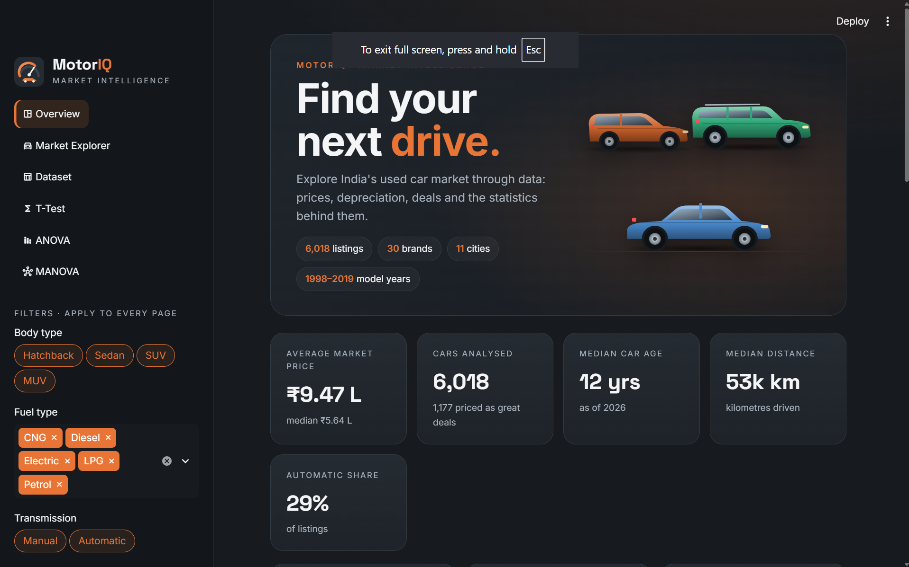
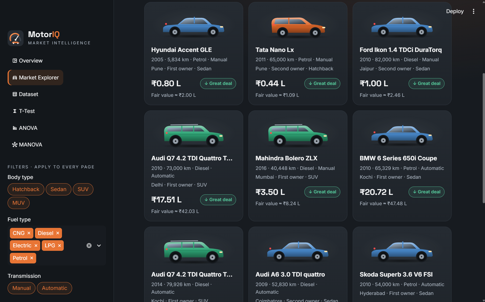

# MotorIQ · Used Car Market Intelligence

**MotorIQ** is an interactive Streamlit dashboard for India's used-car market. It works like a car marketplace and is backed by statistical analysis (T-tests, ANOVA and MANOVA) on 6,000+ real listings.

---

## Table of contents

- [Features](#features)
- [Screenshots](#screenshots)
- [Quick start](#quick-start)
- [Dataset](#dataset)
- [Data cleaning & feature engineering](#data-cleaning--feature-engineering)
- [Statistical methods](#statistical-methods)
- [Fair-value deal model](#fair-value-deal-model)
- [Project structure](#project-structure)
- [Design system](#design-system)
- [Testing](#testing)
- [Limitations](#limitations)

---

## Features

| Page | What it does |
|---|---|
| **Overview** | Market KPIs, body-type tiles with custom SVG cars, and insights computed from the data (value lost per year, automatic and diesel price premiums, priciest city). Four interactive charts: price distribution, median price by brand, depreciation curve and price by fuel type. |
| **Market Explorer** | Searchable, sortable listing cards. Each car gets a deal rating (*Great deal / Fair price / Above market / Check listing*) by comparing its price with a fair-value model. Results are paginated. |
| **Dataset** | Raw vs cleaned data, summary statistics, a step-by-step cleaning log and a filtered CSV download. |
| **T-Test** | One-sample and Welch two-sample t-tests with confidence interval, Cohen's d, Shapiro–Wilk normality and Levene variance checks, and a plain-English verdict. |
| **ANOVA** | 1-, 2- and 3-way ANOVA (Type II sums of squares) with optional interaction terms, η² effect sizes, Tukey HSD post-hoc and box plots. |
| **MANOVA** | Wilks' lambda, Pillai's trace, Hotelling–Lawley and Roy's root, plus a z-score heatmap of each group's profile. |

**Global filters** in the sidebar (body type, fuel, transmission, model year, price range) apply to every page, including the statistical tests. You can, for example, run an ANOVA on automatic diesel SUVs only.

---

## Screenshots

**Overview:** hero banner, KPIs and body-type breakdown



**Market Explorer:** listing cards with SVG illustrations and deal ratings



---

## Quick start

**Requirements:** Python 3.9+

```bash
# 1. Install dependencies (first time only)
pip install -r requirements.txt

# 2. Start the app
streamlit run app.py
```

The app opens at **http://localhost:8501**. Press `Ctrl + C` in the terminal to stop it.

| Problem | Fix |
|---|---|
| `streamlit` is not recognised | `python -m streamlit run app.py` |
| Port 8501 already in use | `streamlit run app.py --server.port 8502` |

A **Dev Container** config (`.devcontainer/`) is included. Opening the repo in GitHub Codespaces or VS Code Dev Containers installs everything and starts the app automatically.

---

## Dataset

`data/used_cars_data1.csv` has **6,019 listings** of used cars across **11 Indian cities**, with model years **1998–2019**.

| Column | Description |
|---|---|
| `Name` | Brand + model + variant, e.g. *Hyundai Creta 1.6 CRDi SX* |
| `Location` | City of sale |
| `Year` | Model year |
| `Kilometers_Driven` | Odometer reading |
| `Fuel_Type` | Petrol, Diesel, CNG, LPG, Electric |
| `Transmission` | Manual / Automatic |
| `Owner_Type` | First, Second, Third, Fourth & Above |
| `Mileage` | Fuel efficiency (kmpl or km/kg) |
| `Engine` | Displacement (CC) |
| `Power` | Maximum power (bhp) |
| `Seats` | Seating capacity |
| `New_Price` | Price when new (mostly missing, so dropped) |
| `Price` | Resale price in **₹ lakh** (target variable) |

---

## Data cleaning & feature engineering

All cleaning happens in `utils/preprocessing.py`:

1. **Units stripped** from Mileage, Engine and Power, then converted to numbers.
2. **Impossible values** (0 mileage, 0 seats) set to missing.
3. **Missing values** filled: Mileage, Engine and Power with the median; Seats with the mode.
4. **Outlier removed:** one listing with 6.5 million km.
5. **`New_Price` dropped:** about 86% missing.
6. **New features:**

| Feature | How it is built |
|---|---|
| `Brand` | First word of `Name`, normalised (*ISUZU → Isuzu*, *Land → Land Rover*) |
| `Model` | Second word of `Name` |
| `Body_Type` | Hatchback / Sedan / SUV / MUV, inferred from model keywords (*Creta → SUV*, *City → Sedan*, *Innova → MUV*). Unknown models fall back to seat count. |
| `Car_Age` | `2026 − Year` |
| `Log_Price` | `ln(Price)`. Prices are heavily right-skewed, so tests on log price are better behaved. |

---

## Statistical methods

All tests live in `utils/stats_tests.py`. The significance level α can be set to 0.01, 0.05 or 0.10.

### T-Test
- **One-sample:** tests whether a variable's mean equals a hypothesised value μ₀. Reports t, p, a (1 − α) confidence interval and Cohen's d.
- **Two-sample (Welch):** compares two groups without assuming equal variances. Levene's test is shown for reference.
- Normality is checked with Shapiro–Wilk (on a fixed 5,000-row sample for large data). With large n, the central limit theorem keeps the t-test reliable.

### ANOVA
- Fits an OLS model with categorical factors and reports a **Type II** ANOVA table.
- **η²** (eta squared) shows the share of total variance each term explains.
- For 1-way designs with up to 15 groups, **Tukey HSD** shows which pairs of groups differ.

### MANOVA
- Tests whether groups differ on **two or more dependent variables together**.
- Reports all four statistics. **Pillai's trace** drives the verdict because it is the most robust to assumption violations.
- A heatmap shows each group's mean on each variable as a z-score, so you can see *how* the groups differ.

**Effect-size guide (Cohen's d):** < 0.2 negligible · 0.2–0.5 small · 0.5–0.8 medium · > 0.8 large.

---

## Fair-value deal model

The Market Explorer rates each listing against a hedonic regression model:

```
log(Price) ~ Car_Age + log(Kilometers_Driven) + Power + Engine
           + Brand + Fuel_Type + Transmission + Body_Type + Owner_Type + Location
```

The model explains about **93%** of the variance in log price (R² ≈ 0.93). Each car's ratio of actual price to fair value gives its rating:

| Ratio | Rating |
|---|---|
| < 0.40 | **Check listing:** too cheap to be real, likely a data-entry error |
| 0.40 – 0.85 | **Great deal** |
| 0.85 – 1.15 | **Fair price** |
| > 1.15 | **Above market** |

---

## Project structure

```
.
├── app.py                   # Streamlit app: layout, pages, charts
├── assets/
│   └── style.css            # Custom dark theme (cards, hero, sidebar, pills)
├── .streamlit/
│   └── config.toml          # Streamlit base theme (colours)
├── data/
│   └── used_cars_data1.csv  # Raw dataset
├── utils/
│   ├── data_loader.py       # Loads CSV and runs cleaning
│   ├── preprocessing.py     # Cleaning + feature engineering + body-type inference
│   ├── stats_tests.py       # T-test, ANOVA, Tukey HSD, MANOVA
│   └── graphics.py          # Inline SVG car illustrations + MotorIQ logo
├── tests/
│   └── test_app.py          # Smoke tests (every page renders, body-type inference)
├── .devcontainer/           # Codespaces / Dev Container setup
├── img1.png, img2.png       # README screenshots
└── requirements.txt
```

---

## Design system

The interface uses no image files. Every car and the logo is **inline SVG** generated in `utils/graphics.py`, so the app loads instantly and looks sharp at any size.

| Element | Colour |
|---|---|
| Background | `#171B20` |
| Card | `#252B32` |
| Primary accent | `#E87535` |
| Secondary text | `#AAB4C0` |
| Positive / good deal | `#55C89A` |
| Main text | `#F4F5F6` |

Each **body type keeps one colour** throughout the app. The four colours were checked with a colour-blindness validator so they stay distinguishable:

| Hatchback | Sedan | SUV | MUV |
|---|---|---|---|
| `#E0682A` | `#4A8CD0` | `#2FA878` | `#A774DB` |

**Fonts:** Inter (body) and Space Grotesk (headings), loaded from Google Fonts. Charts are built with Altair and include hover tooltips.

---

## Testing

```bash
pip install pytest
pytest tests
```

The tests check that every page renders without errors (using Streamlit's `AppTest`) and that body-type inference classifies known models correctly.

---

## Limitations

- **Body type is inferred** from model names, so rare or unusual models may be misclassified. Edit the keyword lists in `utils/preprocessing.py` to correct them.
- **The deal model is fitted and judged on the same data.** Treat ratings as guidance, not valuations.
- **Prices are 2019-era listings.** `Car_Age` is computed relative to 2026, so absolute ages are shifted but comparisons between cars are unaffected.
- **Custom CSS targets Streamlit's internal page structure**, so a major Streamlit upgrade may need small style fixes.
- **Fonts load from Google Fonts.** Offline, the app falls back to system fonts.
